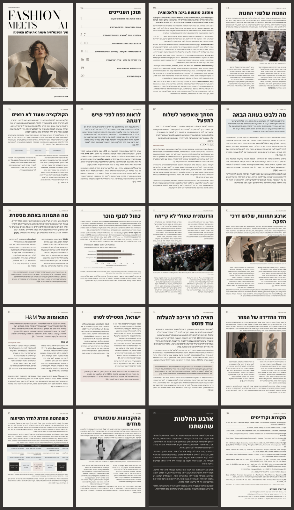
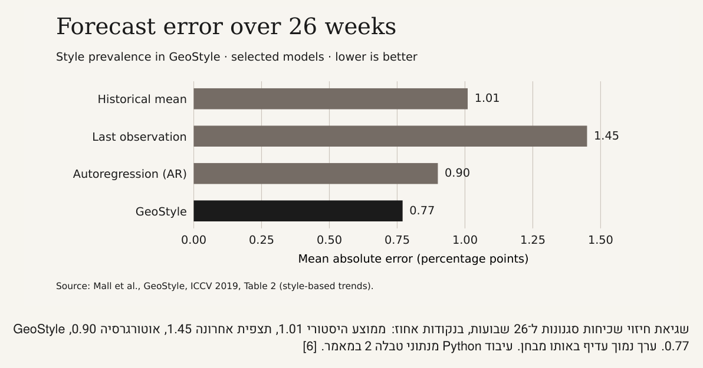
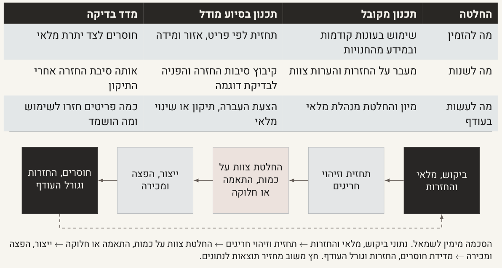
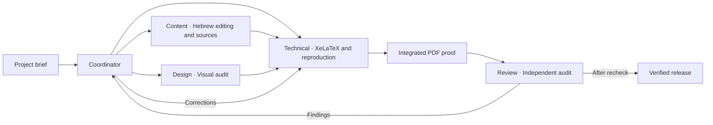

<div align="center">
  <p><strong>ASSIGNMENT 02 · HEBREW FASHION EDITORIAL</strong></p>
  <h1>Fashion Meets AI</h1>
  <p dir="rtl" lang="he"><strong>איך הטכנולוגיה משנה את עולם האופנה</strong></p>
  <p><span dir="rtl" lang="he">אסתר גדליה ורוני כהן</span></p>
  <a href="Fashion-Meets-AI-Assignment-02.pdf"></a>
  <p><a href="Fashion-Meets-AI-Assignment-02.pdf"><strong>Read the complete magazine (PDF)</strong></a> · <a href="docs/assignment-02/contact-sheet.png">Browse all 20 pages</a></p>
</div>

## The issue

Fashion brings together decisions about how a garment should fit, what a buyer should order, and what a campaign should show. This 20-page magazine asks where AI can improve those decisions and what it takes to check the results. It pairs reporting on real workflows with an explicit distinction between documented outcomes, editorial examples, and possibilities for the future.

The design takes its cues from luxury fashion editorials. An ivory, ink, and warm-gray palette keeps the imagery in focus. Bodoni Moda sets the English display, and Heebo gives the Hebrew copy a clear hierarchy across the right-to-left folios.

| Feature | Folios | What it follows |
| --- | --- | --- |
| **01 · Design and development** | 5–7 | How a sketch becomes a sample, what digital fit tools can show, and where a Genpire tech pack fits in the development process. |
| **02 · Trend forecasting** | 8–10 | How WGSN and Heuritech read fashion signals, how a buyer weighs those signals, and what a 26-week forecasting benchmark measures. |
| **03 · Campaigns and virtual models** | 11–15 | From an on-set crew to generated stills, digital twins, and a recurring virtual character. Cases include H&M, Renuar, H&O, and Maya Lor. |
| **04 · The future of fashion** | 16–18 | Virtual try-on, production planning, returns and surplus, and the professional skills needed to evaluate an automated recommendation. |



## The evidence on the page

### Forecast error · Folio 10

The issue uses mean absolute error (MAE) to describe the average distance between a forecast and what was observed. Here, $y_t$ is the observed style prevalence, $\hat y_t$ is the forecast, and $n$ is the number of observations.

$$
\mathrm{MAE} = \frac{1}{n}\sum_{t=1}^{n}\left|y_t-\hat y_t\right|
$$

The worked example compares forecasts of 12% and 9% with observations of 10% in both weeks. The errors are 2 and 1 percentage points, giving an MAE of **1.5 percentage points**. The chart uses separate, published data from **GeoStyle, Table 2**. Its four benchmarks are 1.01 for historical mean, 1.45 for last observation, 0.90 for autoregression, and 0.77 for GeoStyle, all in percentage points. [Source register](content/V5_SOURCES.md) · [Chart data](latex-v5/figures/v4-chart/geostyle_mae.csv)



### Planning trade-offs · Folio 17

The comparison table sets conventional planning beside model-assisted planning and gives each decision a measure to check. For example, an order recommendation can be evaluated against both stockouts and stock left over. The diagram below the table shows how those outcomes feed back into the next planning decision. [Table source](latex-v5/components/production-table.tex) · [Diagram source](latex-v5/components/workflow.tex)



## How the agents worked



The diagram maps the documented handoffs. Two initial assignments were interrupted before producing file revisions and were reassigned. The independent review flagged a production credit it could not corroborate and confirmed that it was replaced with a firsthand account. The bibliography also exposed a mixed-direction PDF issue. Technical restored the missing link annotations and Review checked the corrected release. [Agent activity](AI_AGENT_EVIDENCE.md) · [Prompts](prompts/) · [Development log](DEVELOPMENT_LOG.md) · [Independent audit](reviews/ASSIGNMENT_02_REVIEW.md)

Generative AI supported editorial, layout, and verification work. Four original illustrations were generated with ImageGen and carry disclosures. The two documentary photos retain their attribution and licenses. Source checking and a separate audit were necessary because agent output alone could not establish a factual claim, image permission, or successful build. [Image and license register](latex-v5/BUILD_REPORT.md)

## Reproduce the project

| Technology | Role |
| --- | --- |
| **LaTeX and XeLaTeX** | Typeset the A4 issue, its formula, tables, and clickable references. |
| **Polyglossia and Fontspec** | Handle Hebrew RTL and English runs, using the bundled Heebo and Bodoni Moda families. TeX Gyre Heros and Latin Modern Math come from the TeX distribution. |
| **TikZ** | Draws the vector process diagrams. |
| **Python and Matplotlib** | Generate the forecasting chart from an included CSV. PyMuPDF is used separately for release checks and previews. |

**Build the PDF.** With a full TeX Live or MiKTeX installation, run from the repository root:

```sh
cd latex-v5
xelatex -interaction=nonstopmode -halt-on-error -file-line-error main.tex
xelatex -interaction=nonstopmode -halt-on-error -file-line-error main.tex
```

The second pass resolves references. The local result is `latex-v5/main.pdf`. On Overleaf, upload the contents of `latex-v5/`, select **XeLaTeX**, and use `main.tex` as the main file. The bundled chart lets the PDF build without Python or shell escape.

**Regenerate the chart.** From the repository root:

```sh
python -m pip install -r latex-v5/figures/v4-chart/requirements.txt
python latex-v5/figures/v4-chart/geostyle_mae.py
```

The script reads four proportions, converts them to percentage points, and writes PDF and PNG outputs beside the CSV. To check a local rebuild against the published issue:

```sh
python -m pip install -r scripts/requirements.txt
python scripts/check_assignment_pdf.py Fashion-Meets-AI-Assignment-02.pdf --source latex-v5 --compare latex-v5/main.pdf
```

## Assignment checks

- [x] **20 A4 pages** with Hebrew RTL, byline, and eight verified contents destinations.
- [x] **Python chart and explained MAE formula** on folio 10.
- [x] **Comparison table and feedback diagram** on folio 17.
- [x] **Six credited images**, AI disclosures, and 35 bibliography and credit URLs matched to the PDF annotations.
- [x] **Reproducible release.** Fresh local XeLaTeX builds matched all 20 published pages pixel for pixel at 72 dpi, with matching text and link destinations. The chart regenerated byte for byte.
- [x] **Documented agent work and review** with actual assignments, outcomes, and corrections.
- [ ] **External confirmation.** The exact release has not been verified on hosted Overleaf. Course instructions outside the workspace were unavailable.

[Full compliance matrix](REQUIREMENTS_COMPLIANCE.md) · [Build verification and hashes](BUILD_VERIFICATION.md)

## Repository guide

```text
Fashion-Meets-AI-Assignment-02.pdf  Published issue
latex-v5/                          Main document, folios, layout, fonts, and images
  figures/v4-chart/                Forecasting data, script, and chart outputs
content/                           Hebrew manuscript and source register
docs/assignment-02/                Screenshots from the published PDF
prompts/                           Numbered prompt records
reviews/                           Independent editorial and technical audit
scripts/                           PDF checks and preview rendering
DEVELOPMENT_LOG.md                 Decisions, handoffs, and release evidence
```
